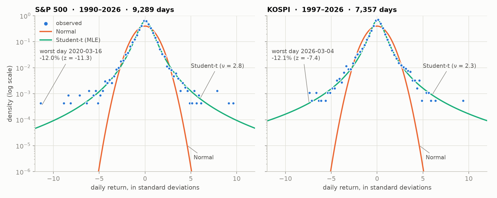
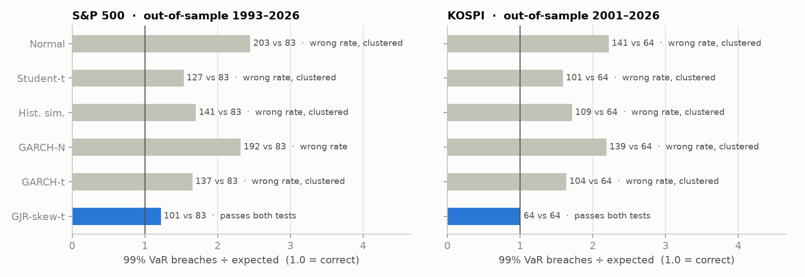
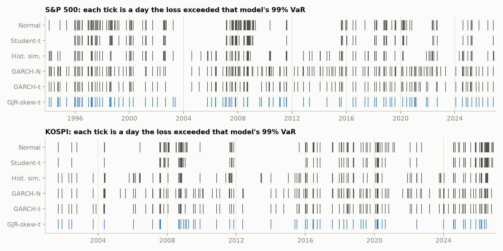
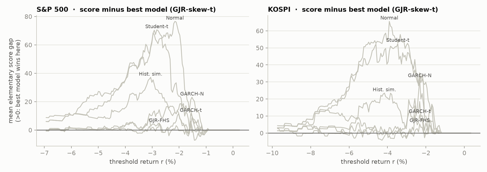
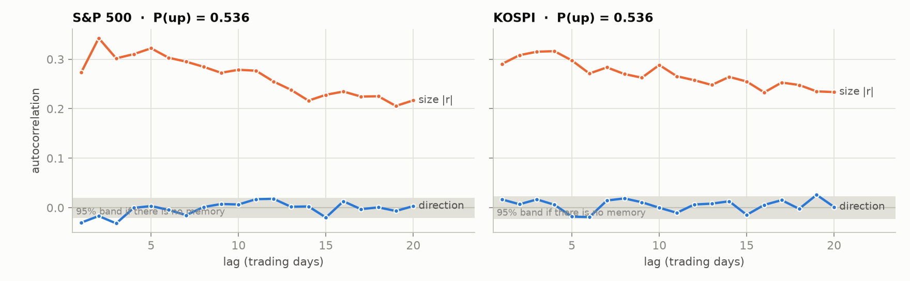
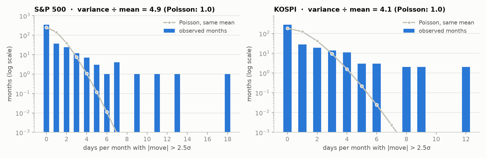
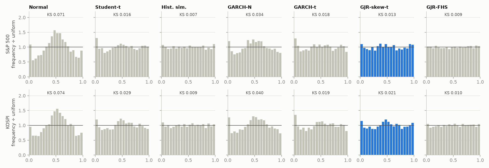

# market-distribution-tests

**Five textbook distributions, each turned into a claim about markets and tested out-of-sample on
S&P 500 and KOSPI daily returns.**

Normal, Student-t, Bernoulli, Poisson and Uniform are usually taught as shapes to draw. Here each one
becomes a falsifiable hypothesis with a proper test, and the results are tied together by one
mechanism: volatility clustering. Forecasts for day *t* use only data up to *t*−1, and a unit test
enforces it.

**Interactive version: [japark22.github.io/market-distribution-tests/](https://japark22.github.io/market-distribution-tests/)**

<picture>
  <source media="(prefers-color-scheme: dark)" srcset="figures/hero-dark.png">
  
</picture>

## Research at a glance

| Hypothesis | Test | S&P 500 (1990–2026, 9,290 days) | KOSPI (1997–2026, 7,357 days) |
|---|---|---|---|
| **H1 Normal**: daily returns are Normal | Jarque-Bera, tail counts | excess kurtosis 10.8; 62 days beyond 4σ vs 0.6 expected<br>**rejected** | excess kurtosis 7.4; 54 days beyond 4σ vs 0.5 expected<br>**rejected** |
| **H2 Student-t**: a fat-tailed t fits instead | MLE ν, AIC, VaR clustering | ν = 2.8; AIC favours t by 2,528; static-t 99% VaR breaches 1.54% of days, clustered (Christoffersen p < 0.0001)<br>**shape yes, timing no** | ν = 2.3; AIC favours t by 2,295; static-t 99% VaR breaches 1.59% of days, clustered (Christoffersen p < 0.0001)<br>**shape yes, timing no** |
| **H3 Bernoulli**: up/down is a memoryless coin | runs test, Markov χ² | P(up after up) 0.522 vs after down 0.553; Markov p = 0.0038<br>**rejected, but the memory is tiny** | P(up after up) 0.544 vs after down 0.527; Markov p = 0.1524<br>**memoryless (but biased toward up days)** |
| **H4 Poisson**: >2.5σ days arrive independently | dispersion test on monthly counts | variance ÷ mean = 4.89 (Poisson: 1); after GARCH-t filtering 1.07<br>**rejected; clustering explains it** | variance ÷ mean = 4.14 (Poisson: 1); after GARCH-t filtering 1.19<br>**rejected; clustering explains it** |
| **H5 Uniform**: forecast PITs are U(0,1) | Berkowitz + 99% VaR coverage and independence | GJR-skew-t: 101 breaches vs 83 expected, Berkowitz p = 0.0864<br>**calibrated: GJR-skew-t** | GJR-skew-t: 64 breaches vs 64 expected, Berkowitz p = 0.0550<br>**calibrated: GJR-skew-t, GJR-FHS** |

**The chain of results.** Returns are **not Normal**: S&P 500 daily excess kurtosis is 10.8, with 62 days beyond 4σ where a Normal expects 0.6. A Student-t **fixes the shape** (KS distance 0.090 → 0.015), but a static t still breaches its 99% VaR on 1.54% of days, and in bunches. The cause is **clustering**: the direction of a day is close to a coin flip (lag-1 sign autocorrelation -0.030), its size is not (+0.273). Clustering also **breaks Poisson**: monthly counts of large moves have variance 4.9× their mean, and 1.07× once a GARCH-t filter takes the clustering out. Adding volatility dynamics reduces the bunching (most breaches in any 10 days: 6 for the static t, 4 for GARCH-t) but not the bias: GARCH-t still breaches on 1.66% of days, and its misses are one-sided (PIT below 1%: 1.66%, above 99%: 0.48%). The last rung, **GJR-GARCH with skewed-t shocks**, lets bad news raise volatility more than good news and gives the left tail more weight. It is the only model whose 99% VaR passes both the Kupiec and Christoffersen tests and whose PITs pass Berkowitz in both markets: S&P 500: 101 breaches vs 83 expected; KOSPI: 64 breaches vs 64 expected.

## H1 Normal and H2 Student-t: the tails

- **S&P 500**: worst day 2020-03-16 at -12.0% (z = -11.3); best day 2008-10-13 at +11.6%. Under a Normal, a day as bad as the worst should come once every 5.1e+26 years. Excess kurtosis falls from 10.8 (daily) to 4.9 (weekly) and 2.4 (monthly).
- **KOSPI**: worst day 2026-03-04 at -12.1% (z = -7.4); best day 2026-07-31 at +17.9%. Under a Normal, a day as bad as the worst should come once every 6.9e+10 years. Excess kurtosis falls from 7.4 (daily) to 3.6 (weekly) and 2.0 (monthly).

Fat tails shrink as returns are aggregated, but a Student-t with ν around
2.8 (S&P 500), 2.3 (KOSPI) describes the daily shape far
better than the Normal. But one ν cannot fit every regime: ν = 2.8 for S&P 500, ν = 2.3 for KOSPI are below 3, where the t has no finite fourth moment, and the fitted t over-predicts the most extreme days (beyond 5σ: S&P 500 30 observed vs 42 predicted; KOSPI 19 observed vs 52 predicted). A single static t is averaging calm and stressed periods, which is a sign that volatility moves over time. The real test is a forecast. Six models, each adding one ingredient, plus one challenger, produce a
one-day 99% VaR every day, out-of-sample. ✅ means the model passes Kupiec, Christoffersen and Berkowitz
(all p > 0.05).

| Model | What it adds | S&P 500: 99% breach rate (target 1.00%) | KOSPI: 99% breach rate (target 1.00%) |
|---|---|---:|---:|
| Normal | baseline: Normal fitted to the last 1000 days | 2.46% ❌ | 2.23% ❌ |
| Student-t | fat tails (shape) | 1.54% ❌ | 1.59% ❌ |
| Hist. sim. | no shape assumption (last 250 days) | 1.72% ❌ | 1.71% ❌ |
| GARCH-N | volatility clustering (timing) | 2.33% ❌ | 2.19% ❌ |
| GARCH-t | clustering + fat tails | 1.66% ❌ | 1.64% ❌ |
| GJR-skew-t | clustering + fat tails + asymmetry (bad news raises volatility more; heavier left tail) | 1.22% ✅ | 1.01% ✅ |
| GJR-FHS | challenger: same GJR dynamics, but shocks drawn from the empirical residuals instead of a skewed-t | 1.29% ❌ | 1.13% ✅ |

Median GJR-skew-t parameters across monthly refits (S&P 500: α = 0.000, γ = 0.172, β = 0.892, skew λ = -0.133; KOSPI: α = 0.000, γ = 0.137, β = 0.874, skew λ = -0.132). α near zero with a large γ means volatility responds mainly to *down* days, and λ < 0 is a heavier left tail: the two asymmetries the symmetric models were missing.

<picture>
  <source media="(prefers-color-scheme: dark)" srcset="figures/var_breaches-dark.png">
  
</picture>

| Market | Model | Breaches | Expected | Rate | Kupiec p (right rate) | Christoffersen p (no clustering) |
|---|---|---:|---:|---:|---:|---:|
| S&P 500 | Normal | 204 | 83 | 2.46% | <0.0001 | <0.0001 |
| S&P 500 | Student-t | 128 | 83 | 1.54% | <0.0001 | <0.0001 |
| S&P 500 | Hist. sim. | 143 | 83 | 1.72% | <0.0001 | <0.0001 |
| S&P 500 | GARCH-N | 193 | 83 | 2.33% | <0.0001 | 0.1224 |
| S&P 500 | GARCH-t | 138 | 83 | 1.66% | <0.0001 | 0.0102 |
| S&P 500 | GJR-skew-t | 101 | 83 | 1.22% | 0.0534 | 0.5191 |
| S&P 500 | GJR-FHS | 107 | 83 | 1.29% | 0.0109 | 0.6167 |
| KOSPI | Normal | 142 | 64 | 2.23% | <0.0001 | <0.0001 |
| KOSPI | Student-t | 101 | 64 | 1.59% | <0.0001 | <0.0001 |
| KOSPI | Hist. sim. | 109 | 64 | 1.71% | <0.0001 | 0.0001 |
| KOSPI | GARCH-N | 139 | 64 | 2.19% | <0.0001 | 0.0457 |
| KOSPI | GARCH-t | 104 | 64 | 1.64% | <0.0001 | 0.0360 |
| KOSPI | GJR-skew-t | 64 | 64 | 1.01% | 0.9568 | 0.1706 |
| KOSPI | GJR-FHS | 72 | 64 | 1.13% | 0.2981 | 0.2618 |

At the 95% level the picture is different, because the fat tails matter less that close to the centre. Models with the right breach rate (Kupiec p > 0.05): S&P 500: Normal, GJR-FHS; KOSPI: Normal, GJR-FHS. Models that also pass Christoffersen: S&P 500: GJR-FHS; KOSPI: GJR-FHS. GJR-skew-t at 95%: S&P 500 457 vs 414, Kupiec p = 0.0350; KOSPI 364 vs 318, Kupiec p = 0.0094.

Where the breaches land in time shows why the unconditional models fail: they arrive in bursts
during stress periods.

<picture>
  <source media="(prefers-color-scheme: dark)" srcset="figures/breach_timeline-dark.png">
  
</picture>

## Expected Shortfall: how deep the tail is, not just how often

Passing a VaR test means the *number* of breaches is right; it says nothing about how bad they are. Expected Shortfall -- the average loss on a breach day -- is the measure Basel III / FRTB now mandates, and because it is not elicitable it needs its own backtest. Each model's ES is read off the same predictive distribution as its VaR and tested with the Acerbi-Szekely (2014) Z2 statistic (E[Z2] = 0 when the ES is right; Z2 > 0 means realised losses exceed the model's ES), with bootstrap p-values. The realised column averages the actual return on the model's own breach days.

| Market | Model | Forecast ES | Realised ES | Realised / forecast | Z2 | Z2 p |
|---|---|---:|---:|---:|---:|---:|
| S&P 500 | Normal | -2.52% | -3.35% | 1.33 | +2.29 | <0.0001 ❌ |
| S&P 500 | Student-t | -3.78% | -3.79% | 1.00 | +0.63 | <0.0001 ❌ |
| S&P 500 | Hist. sim. | -3.26% | -3.33% | 1.02 | +0.78 | <0.0001 ❌ |
| S&P 500 | GARCH-N | -2.37% | -2.71% | 1.14 | +1.70 | <0.0001 ❌ |
| S&P 500 | GARCH-t | -2.75% | -2.79% | 1.01 | +0.71 | <0.0001 ❌ |
| S&P 500 | GJR-skew-t | -2.72% | -2.83% | 1.04 | +0.30 | 0.0160 ❌ |
| S&P 500 | GJR-FHS | -2.91% | -2.83% | 0.97 | +0.29 | 0.0140 ❌ |
| KOSPI | Normal | -3.37% | -4.55% | 1.35 | +2.03 | <0.0001 ❌ |
| KOSPI | Student-t | -4.80% | -5.09% | 1.06 | +0.78 | <0.0001 ❌ |
| KOSPI | Hist. sim. | -4.56% | -4.43% | 0.97 | +0.74 | <0.0001 ❌ |
| KOSPI | GARCH-N | -3.37% | -3.85% | 1.14 | +1.50 | <0.0001 ❌ |
| KOSPI | GARCH-t | -4.17% | -4.21% | 1.01 | +0.65 | <0.0001 ❌ |
| KOSPI | GJR-skew-t | -4.28% | -4.54% | 1.06 | +0.06 | 0.6550 ✅ |
| KOSPI | GJR-FHS | -4.16% | -4.31% | 1.04 | +0.19 | 0.1800 ✅ |

Models whose 99% ES is not rejected in either market: none. Models that pass the 99% VaR count and independence tests but whose ES is still rejected (realised tail deeper than forecast): S&P 500: GJR-skew-t; KOSPI: none. Realised ÷ forecast ES at 99% (1.00 = right): S&P 500 Normal 1.33, Student-t 1.00, Hist. sim. 1.02, GARCH-N 1.14, GARCH-t 1.01, GJR-skew-t 1.04, GJR-FHS 0.97; KOSPI Normal 1.35, Student-t 1.06, Hist. sim. 0.97, GARCH-N 1.14, GARCH-t 1.01, GJR-skew-t 1.06, GJR-FHS 1.04. With several thousand out-of-sample days the Z2 test can reject small, persistent shortfalls, so read the ratio as the effect size: across both markets it runs from 1.35 (Normal) to 1.00 (Student-t).

## Which forecast is sharpest: a graded ranking, not pass/fail

A VaR test and an ES test each give a verdict per model; neither says which calibrated model is *better*, nor whether a gap between two models is real or noise. The 2016 result that resolves ES's non-elicitability is that the pair (VaR, ES) is **jointly** elicitable: there is a strictly consistent scoring function for the two together even though ES has none alone. Scoring every model each day with the Fissler-Ziegel 0-homogeneous loss (lower = sharper), comparing each with the best by a Diebold-Mariano test, and running Hansen-Lunde-Nason's Model Confidence Set turns the ladder into an ordering with error control. The loss is scale-invariant, so days of calm and crisis contribute on the same footing.

| Market | Model | FZ loss (99%) | DM vs best | MCS p-value |
|---|---|---:|---:|---:|
| S&P 500 | Normal | -2.5606 | +4.27 (p < 0.0001) | <0.0001 ❌ |
| S&P 500 | Student-t | -2.8617 | +4.54 (p < 0.0001) | <0.0001 ❌ |
| S&P 500 | Hist. sim. | -3.1469 | +3.41 (p = 0.0007) | 0.0075 ❌ |
| S&P 500 | GARCH-N | -3.1916 | +4.84 (p < 0.0001) | <0.0001 ❌ |
| S&P 500 | GARCH-t | -3.3474 | +1.81 (p = 0.0697) | 1.0000 ✅ |
| S&P 500 | GJR-skew-t | -3.3889 | +0.15 (p = 0.8808) | 1.0000 ✅ |
| S&P 500 | GJR-FHS | -3.3899 | best | 1.0000 ✅ |
| KOSPI | Normal | -2.3829 | +4.35 (p < 0.0001) | 0.0010 ❌ |
| KOSPI | Student-t | -2.6224 | +4.47 (p < 0.0001) | 0.0010 ❌ |
| KOSPI | Hist. sim. | -2.9586 | +4.03 (p < 0.0001) | 0.0010 ❌ |
| KOSPI | GARCH-N | -3.0162 | +4.18 (p < 0.0001) | 0.0010 ❌ |
| KOSPI | GARCH-t | -3.1559 | +2.02 (p = 0.0429) | 0.0625 ❌ |
| KOSPI | GJR-skew-t | -3.1944 | best | 1.0000 ✅ |
| KOSPI | GJR-FHS | -3.1792 | +2.19 (p = 0.0284) | 0.0625 ❌ |

Lowest average loss (the sharpest joint VaR/ES forecast) at 99%: S&P 500 **GJR-FHS**; KOSPI **GJR-skew-t**. The 90% Model Confidence Set -- the models that cannot be told apart from the best -- is S&P 500: {GARCH-t, GJR-skew-t, GJR-FHS} at 99%, {GJR-skew-t, GJR-FHS} at 95%; KOSPI: {GJR-skew-t} at 99%, {GJR-skew-t, GJR-FHS} at 95%. **Is it stable, or carried by a few crises?** Scoring each calendar year separately: S&P 500: GJR-FHS is the best model in 7 of 34 calendar years and beats the runner-up (GJR-skew-t) in 15 of 34 (sign test p = 0.6076); KOSPI: GJR-skew-t is the best model in 9 of 26 calendar years and beats the runner-up (GJR-FHS) in 15 of 26 (sign test p = 0.5572) (`results/fz_by_year.csv`). Year by year the best model and the runner-up trade places often enough that a single year of data would not separate them; the full-sample gap is a modest edge that only becomes significant over decades.

### Robust or just lucky? Murphy diagrams

A ranking by one loss (above) can flip under another. Ehm, Gneiting, Jordan & Kruger (2016) show every consistent scoring function for a quantile is a mixture of **elementary scores**, one per threshold. Plotting the mean elementary score against the threshold (the Murphy diagram) settles it: if one forecast's curve lies below another's *everywhere*, it wins under every reasonable loss, not just the one chosen. The chart shows each model's score minus the best model's.

<picture>
  <source media="(prefers-color-scheme: dark)" srcset="figures/murphy-dark.png">
  
</picture>

- **S&P 500**: lowest pinball loss is **GJR-skew-t**. Against each rival it has the lower elementary score at 56–95% of the thresholds where the two differ, and 58–99% of the total score gap is in its favour.
- **KOSPI**: lowest pinball loss is **GJR-skew-t**. Against each rival it has the lower elementary score at 47–99% of the thresholds where the two differ, and 64–100% of the total score gap is in its favour.

For at least one rival a large share of the score gap lies on the other side, so which model is 'best' depends on which part of the tail a loss emphasises. The average ranking above should be read with that caveat.

## H3 Bernoulli: is each day a coin flip?

- **S&P 500**: lag-1 autocorrelation of the sign is -0.030; of the absolute return it is +0.273. Ljung-Box(10) p-value: sign 0.0089, size <0.0001.
- **KOSPI**: lag-1 autocorrelation of the sign is +0.017; of the absolute return it is +0.290. Ljung-Box(10) p-value: sign 0.1397, size <0.0001.

<picture>
  <source media="(prefers-color-scheme: dark)" srcset="figures/bernoulli-dark.png">
  
</picture>

## H4 Poisson: do big moves arrive independently?

Threshold fixed in advance at 2.5σ (full-sample σ). Counts are per calendar month.

- **S&P 500**: 249 days beyond 2.5σ across 443 months. Months with none: 79% observed vs 57% under Poisson. Busiest month: 18 days (Poisson probability of that many or more: 2.9e-21). On the out-of-sample window the dispersion is 4.93 for raw σ-events and 1.07 for GARCH-t tail events (p = 0.1579).
- **KOSPI**: 243 days beyond 2.5σ across 359 months. Months with none: 77% observed vs 51% under Poisson. Busiest month: 12 days (Poisson probability of that many or more: 1.0e-11). On the out-of-sample window the dispersion is 4.49 for raw σ-events and 1.19 for GARCH-t tail events (p = 0.0139).

Sensitivity of the dispersion ratio to the threshold: S&P 500: 2.0σ → 4.52, 2.5σ → 4.89, 3.0σ → 5.37; KOSPI: 2.0σ → 4.42, 2.5σ → 4.14, 3.0σ → 3.71.

<picture>
  <source media="(prefers-color-scheme: dark)" srcset="figures/poisson-dark.png">
  
</picture>

## H5 Uniform: are the forecasts calibrated?

The probability integral transform F<sub>t|t−1</sub>(r<sub>t</sub>) of a correct forecast is
Uniform(0,1) and independent over time (Diebold, Gunther and Tay, 1998). The Berkowitz (2001)
test checks mean, variance and autocorrelation of Φ<sup>−1</sup>(PIT) jointly.

<picture>
  <source media="(prefers-color-scheme: dark)" srcset="figures/pit-dark.png">
  
</picture>

| Market | Model | KS distance | Berkowitz p | PIT < 1% | PIT > 99% |
|---|---|---:|---:|---:|---:|
| S&P 500 | Normal | 0.0713 | <0.0001 | 2.46% | 1.76% |
| S&P 500 | Student-t | 0.0162 | <0.0001 | 1.54% | 1.01% |
| S&P 500 | Hist. sim. | 0.0073 | 0.0043 | 1.52% | 1.59% |
| S&P 500 | GARCH-N | 0.0333 | <0.0001 | 2.33% | 0.84% |
| S&P 500 | GARCH-t | 0.0179 | 0.0005 | 1.66% | 0.48% |
| S&P 500 | GJR-skew-t | 0.0126 | 0.0864 | 1.22% | 0.81% |
| S&P 500 | GJR-FHS | 0.0094 | 0.1687 | 1.18% | 1.04% |
| KOSPI | Normal | 0.0745 | <0.0001 | 2.23% | 1.21% |
| KOSPI | Student-t | 0.0291 | 0.5728 | 1.59% | 0.87% |
| KOSPI | Hist. sim. | 0.0093 | 0.5610 | 1.43% | 1.38% |
| KOSPI | GARCH-N | 0.0402 | 0.0033 | 2.19% | 0.91% |
| KOSPI | GARCH-t | 0.0194 | 0.0035 | 1.64% | 0.49% |
| KOSPI | GJR-skew-t | 0.0215 | 0.0550 | 1.01% | 1.05% |
| KOSPI | GJR-FHS | 0.0098 | 0.0843 | 1.07% | 1.13% |

With several thousand out-of-sample days these tests have a lot of power, so even a good model can be
rejected for small deviations. Read the KS distance and the tail frequencies as effect sizes.
Historical simulation has the smallest KS distance but still fails in the tails, which is why the
calibration verdict also requires the 99% VaR tests. (Its PIT is a mid-rank among 250 past returns while
its VaR is an interpolated quantile, so its two 1% rates differ slightly.)

## Method

| | |
|---|---|
| Data | Yahoo Finance index closes (`^GSPC`, `^KS11`), daily log returns. Index levels, not total return. |
| Cleaning | Weekend rows and unchanged-close zero-volume rows (stale holiday prints) dropped. Moves above 10% are kept and listed in `results/data_quality.csv` for review. |
| Static models | Normal and Student-t (MLE) on the trailing 1000 days; historical simulation on the trailing 250 days. |
| GARCH | GARCH(1,1) with Normal or standardised-t shocks, and GJR-GARCH(1,1) with Hansen skewed-t shocks; constant mean (`arch`). GJR-FHS keeps the GJR fit but takes the shock quantiles and ES from the window's own standardised residuals (filtered historical simulation). Re-estimated every 21 days on the trailing 1000 days; variance filtered forward daily with fixed parameters. |
| Point-in-time | Every forecast for day *t* uses returns dated *t*−1 or earlier. `tests/test_forecast.py` multiplies all returns after a cut-off by 5 and checks that earlier forecasts do not move. |
| VaR tests | Kupiec (1995) unconditional coverage, Christoffersen (1998) independence. |
| ES backtest | Acerbi-Szekely (2014) Z2 statistic with bootstrap p-values; ES read off the same predictive law as the VaR. |
| Model ranking | Fissler-Ziegel 0-homogeneous joint (VaR, ES) loss, Diebold-Mariano (1995) tests, and the Hansen-Lunde-Nason (2011) Model Confidence Set (moving-block bootstrap); Murphy diagrams (Ehm et al. 2016) for threshold-wise dominance. |
| Refresh | GitHub Actions re-downloads prices, reruns the tests, and regenerates this README, the figures and the site every week. |

Last run: 2026-11-21T09:53:05Z. All numbers above are read from [`results/summary.json`](results/summary.json).

## Limitations

- **Index levels without dividends.** This understates the mean by roughly the dividend yield, which
  barely matters for one-day tails but does shift the share of up days slightly.
- **Single-name price limits.** Korean stocks had a ±15% daily limit until June 2015 (±30% since),
  which can truncate KOSPI index tails in the earlier years.
- **Many tests, large samples.** Some p-values will be small by chance or for economically trivial
  deviations. The figures and effect sizes matter more than any single p-value.
- **One passing model is not a proven model.** GJR-skew-t passing at 99% is one level, two markets,
  and a handful of tests; it was added after the symmetric models failed, so treat it as the next
  hypothesis, not a final answer. No realised-volatility inputs or regime switching are tried.
- **Extreme days are kept, not trimmed.** S&P 500 worst 2020-03-16 (-12.0%), best 2008-10-13 (+11.6%); KOSPI worst 2026-03-04 (-12.1%), best 2026-07-31 (+17.9%). `results/data_quality.csv` lists all 13 moves above 10%; 0 of them reverse the next day (the signature of a bad print). Recent extremes carry a lot of weight in tail statistics, so results can move when the weekly refresh adds a crisis.

## Reproduce

```bash
pip install -r requirements.txt
python scripts/run_all.py --refresh   # download prices, run every test (about 3 minutes)
python scripts/make_figures.py
python scripts/build_readme.py
pytest -q                             # simulation-based tests, including the no-lookahead check
```

```
mdt/forecast.py      rolling out-of-sample predictive distributions (7 models)
mdt/hypotheses.py    H1 to H5 tests, Kupiec, Christoffersen, Berkowitz
mdt/data.py          download, cleaning audit, log returns
scripts/             run_all, make_figures, build_readme
docs/                GitHub Pages site (index.html + data.json)
results/             summary.json, CSV outputs, GJR-skew-t parameter paths, run_log.csv
tests/               known-distribution simulations and the lookahead test
```

## References

- Acerbi, C., Szekely, B. (2014). Backtesting expected shortfall. *Risk*.
- Barone-Adesi, G., Giannopoulos, K., Vosper, L. (1999). VaR without correlations for portfolios of derivative securities. *Journal of Futures Markets*.
- Berkowitz, J. (2001). Testing density forecasts, with applications to risk management. *JBES*.
- Christoffersen, P. (1998). Evaluating interval forecasts. *International Economic Review*.
- Cont, R. (2001). Empirical properties of asset returns: stylized facts and statistical issues. *Quantitative Finance*.
- Diebold, F., Gunther, T., Tay, A. (1998). Evaluating density forecasts. *International Economic Review*.
- Diebold, F., Mariano, R. (1995). Comparing predictive accuracy. *Journal of Business & Economic Statistics*.
- Ehm, W., Gneiting, T., Jordan, A., Kruger, F. (2016). Of quantiles and expectiles: consistent scoring functions, Choquet representations and forecast rankings. *JRSS-B*.
- Fissler, T., Ziegel, J. (2016). Higher order elicitability and Osband's principle. *Annals of Statistics*.
- Hansen, P., Lunde, A., Nason, J. (2011). The model confidence set. *Econometrica*.
- Kupiec, P. (1995). Techniques for verifying the accuracy of risk measurement models. *Journal of Derivatives*.
- Nolde, N., Ziegel, J. (2017). Elicitability and backtesting: perspectives for banking regulation. *Annals of Applied Statistics*.
- Patton, A., Ziegel, J., Chen, R. (2019). Dynamic semiparametric models for expected shortfall (and value-at-risk). *Journal of Econometrics*.
